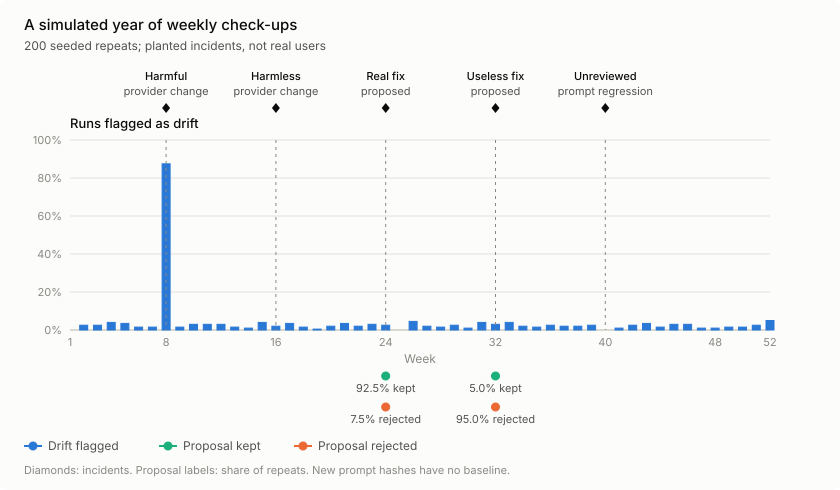

<div align="center">

# promptcheckup

[](https://github.com/gael55x/promptcheckup/actions/workflows/ci.yml)
[](https://pypi.org/project/promptcheckup/)
[](https://github.com/gael55x/promptcheckup/blob/main/pyproject.toml)
[](https://github.com/gael55x/promptcheckup/blob/main/LICENSE)

</div>

Test whether a prompt change actually made your AI agent better.

promptcheckup runs the same cases through your old prompt and your new one, compares the two answers for each case, and gives one of three verdicts: better, worse, or not sure yet. It has no dependencies outside the Python standard library and works with agents written in any language.

<p align="center">

</p>

This chart is why the tool exists. If you compare last week's prompt with this week's, you are mostly measuring what changed between the two weeks. In this simulation that picked the worse prompt 41.3% of the time. Running both prompts on the same inputs picked it 0% of the time.

## Install

```bash
pip install promptcheckup
```

Requires Python 3.11 or newer.

## Usage

```bash
promptcheckup init
```

This writes `promptcheckup.toml`, a few example cases and two GitHub workflows. Edit the config so it points at your agent, your prompt files and your cases. The agent can be a Python function `run(case, prompts)` or any program that reads JSON on stdin and writes JSON on stdout. The [connection guide](https://github.com/gael55x/promptcheckup/blob/main/docs/connect-your-agent.md) has adapters for plain Python, the OpenAI and Anthropic SDKs, and Node.js.

Check the setup, then compare your working tree with `main`:

```bash
promptcheckup doctor
promptcheckup gate --old-ref origin/main --out report.md
```

The first line of the report is the verdict:

```text
B is better: 28 of 30 cases improved (95% CI +0.78 to +0.99).
```

`gate` exits with 0 for better, 1 for worse, 2 for not sure yet and 3 for errors, so it can run in CI. Before it starts, it shows how many agent and judge calls it plans to make and asks for confirmation. Pass `--yes` to skip the question.

### Other commands

| Command | What it does |
|---|---|
| `promptcheckup checkup` | The weekly check. Compares this week's answers with last week's to catch silent model or provider changes, groups failing cases, and proposes one small prompt edit. The edit is kept only if it passes the gate. |
| `promptcheckup evolve` | Repeats the proposal step for several rounds. Edits are written from one part of your cases and tested on another part they never saw, and each round has to clear a higher bar. |
| `promptcheckup propose` | Proposes one edit without the drift check. |
| `promptcheckup doctor` | Checks the config, prompts, cases, agent, scoring, judge and budget, and says what to fix. |

None of these merge anything. Edits that pass are written to your prompt files, and the workflow templates open a pull request for you to review.

### In your tests

```python
from promptcheckup.testing import assert_better, assert_no_lookahead

def test_new_prompt_is_better():
    assert_better(run, cases, old_prompts, new_prompts, score=score)

def test_agent_cannot_see_the_future():
    assert_no_lookahead(build_input, history, decision_times, time_key="date")
```

`assert_no_lookahead` is for agents that work on time series. It changes every number after each decision time and fails if the agent's input changes.

### Scoring

If you can compute how good an answer is, pass a `score(case, output)` function. For a trading agent that might be next-day profit and loss. Otherwise, write criteria and let a model judge pairs of answers. The judge sees both answers in both orders, and before its verdict counts it is checked against itself on old prompt versus old prompt, which should come out even.

## How the verdict is made

For each case, promptcheckup subtracts the old prompt's score from the new prompt's score. It then computes a 95% confidence interval for the average difference using a paired t-test.

- If the whole interval is above zero, the verdict is better.
- If the whole interval is below zero, the verdict is worse.
- Otherwise the verdict is not sure yet. It also says not sure yet with fewer than 20 cases, or when a few large losses are hidden among many small gains.

More detail is in [DESIGN.md](https://github.com/gael55x/promptcheckup/blob/main/DESIGN.md).

## Results

These come from seeded simulations of the shipped code and a few runs against real models. The commands to reproduce them are at the end of this section.

**False "better" verdicts.** When the two prompts were equally good, the gate said better 2.2–2.7% of the time on normal, heavy-tailed and judge-score noise, against a 2.5% target. On trading-style P&L with rare crashes, a plain t-test said better 9–13% of the time. With the skew guard it was 2.0% at 20 cases and almost never at 50 or more.


**How many cases you need.** The chance of detecting a real improvement depends on its size, measured in standard deviations of the per-case noise.

| Improvement | 20 cases | 50 cases | 120 cases |
|---|---|---|---|
| Large (0.8 SD) | 82% | 95% | 98% |
| Medium (0.5 SD) | 50% | 88% | 99% |
| Small (0.2 SD) | 11% | 28% | 59% |


**A simulated year of weekly check-ups.** This ran 200 simulated years of 52 weeks each through the real check-up code, with 50 cases and five planted incidents.

| Incident | Result in that week |
|---|---|
| Provider change that made answers worse (0.5 SD) | flagged in 87.5% of years |
| Provider change with no effect on quality | flagged in 2.0% |
| Worse prompt merged without review | flagged in 98.5% |
| Real fix proposed | kept in 92.5% |
| Useless edit proposed | rejected in 95.0% |

Quiet weeks raised a false drift alarm 2.3% of the time, about once a year. The useless-edit row comes from one week per simulated year, so it is noisy. Gating that same edit another 2,000 times wrongly kept it 2.05% of the time.



**Real models.** In the support-bot example, Claude Haiku 5.5, Sonnet 5.5 and Opus 5.5 each judged the same 30 cases, and each passed the self-check with 100% order consistency. A full gate with Haiku as the judge took 180 judge calls (58,330 input and 40,108 output tokens).

**Trading example.** A model-driven trader compared a trend-following policy with the same policy plus a risk rule, on 60 cases from a synthetic market. The new policy won 26 cases and lost 13, but the gate said not sure yet (+12.76 bp per case, 95% CI −11.04 to +36.57). Applying both policies to all 2,085 days in the market shows why: the real difference is +1.37 bp, too small to tell apart from zero.

### What this means in practice

- You can act on a "better" verdict. When the prompts were equally good, the gate called the new one better less than 2.7% of the time on every kind of noise tested.
- "Not sure yet" usually means you need more cases. Twenty cases only reliably catch large improvements. Plan on about 50 for a medium improvement and well over 120 for a small one.
- Compare prompts on the same inputs. Comparing across days or weeks picked the worse prompt in 41% of runs.
- Every variant you test on the same cases adds about a 2.5% chance of a false "better", so ten tries give about a 22% chance of at least one. Use fresh cases, raise `run.confidence`, or let `evolve` raise the bar for you. The trial ledger in `.promptcheckup/trials.jsonl` keeps count and warns you.
- Expect about one false drift alarm a year from the weekly check-up. Look at the cases that changed most in the report before acting on it.
- In trading, an edge of a few basis points is small next to daily noise, so even thousands of cases may not settle it. What the gate does reliably is stop you from shipping a lucky backtest.

```bash
PYTHONPATH=src python benchmarks/run_gate_benchmark.py                    # about 40 seconds
PYTHONPATH=src python benchmarks/run_checkup_simulation.py --repeats 200  # about 30 seconds
python benchmarks/charts.py
```

## Examples

- [planted](https://github.com/gael55x/promptcheckup/tree/main/examples/planted): naive versus paired comparison, with no API key needed.
- [support-bot](https://github.com/gael55x/promptcheckup/tree/main/examples/support-bot): a judge-mode quickstart, with saved reports from three hosted judges.
- [trading](https://github.com/gael55x/promptcheckup/tree/main/examples/trading): a model-driven trader on a seeded synthetic market. It ships with recorded model replies, so no key is needed, and includes a test showing it never sees future prices.
- [connect](https://github.com/gael55x/promptcheckup/tree/main/examples/connect): tested adapters for plain Python, the OpenAI and Anthropic SDKs, Node.js, and the test helpers.

## Limitations

- Small improvements need many cases. See the table above.
- Live tools such as web search can return different results on the two runs. Running them back to back helps, and when the noise is still too high the gate says not sure yet.
- The gate can't fix a biased set of cases. Pick cases before you look at results, from recorded traffic or with a fixed rule.
- The weekly check-up only notices an unreviewed prompt regression after it has been merged, so run `gate` on pull requests.

## FAQ

**Does it send my data anywhere?** Only to the model endpoint you configure, and only after your `redact` function has run. In score mode, promptcheckup itself makes no network calls.

**Will it change my prompts on its own?** It writes an edit to your prompt files only after the edit passes the gate. It never merges, deploys or pushes.

**Which judge model should I use?** One at least as capable as your agent's own model. Any OpenAI-compatible endpoint works, including Anthropic's at `https://api.anthropic.com/v1`.

**Is this financial advice?** No. It is a research and engineering tool.

## Credits

promptcheckup builds on ideas from these papers. It implements them from the papers' descriptions and copies no code.

- [MemTrial](https://arxiv.org/abs/2610.11732) (Wu, Cai and Wang): comparing decisions on the same inputs so shared noise cancels.
- [EvolveTrade](https://arxiv.org/abs/2609.17632) (Kim, Choi, Kang and Hwang): rewriting an agent's prompt from its own decisions and outcomes.
- [SHARP](https://arxiv.org/abs/2605.06822) (Chen et al.): small, attributable, validated policy edits.
- [ATLAS](https://arxiv.org/abs/2510.15949) (Papadakis et al.) and GEPA (Agrawal et al.): earlier work on feedback-driven prompt optimization.

To cite promptcheckup, use [CITATION.cff](https://github.com/gael55x/promptcheckup/blob/main/CITATION.cff) or GitHub's "Cite this repository" button.

## Contributing

Issues and pull requests are welcome.

```bash
git clone https://github.com/gael55x/promptcheckup && cd promptcheckup
python3 -m venv .venv
.venv/bin/pip install pytest==9.1.1 ruff==0.17.1
.venv/bin/pytest
.venv/bin/ruff check . && .venv/bin/ruff format --check .
```

Changes are made test-first and use [Conventional Commits](https://www.conventionalcommits.org/). Release notes are in the [changelog](https://github.com/gael55x/promptcheckup/blob/main/CHANGELOG.md).

## License

[Apache License 2.0](https://github.com/gael55x/promptcheckup/blob/main/LICENSE)
