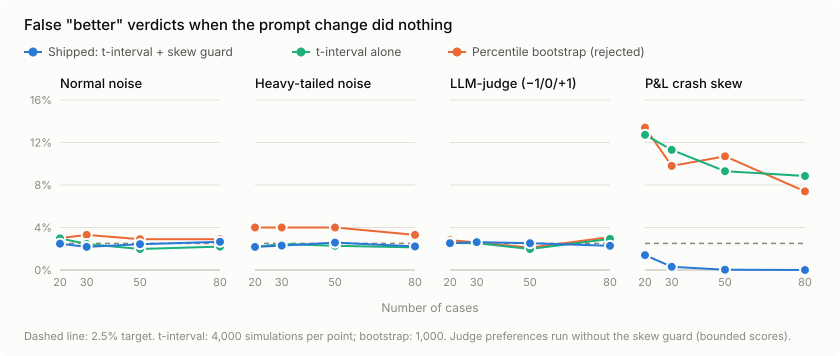
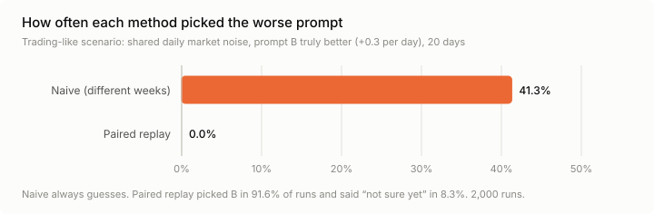
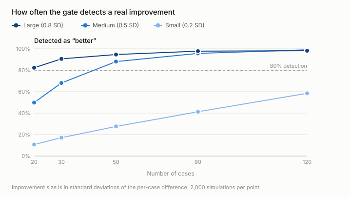

# promptcheckup

Prove a prompt change made your AI agent better, with paired replay.

Status: early development. Nothing is released yet. See [DESIGN.md](DESIGN.md) for the v1.0 plan.

## Benchmarks

The gate is the core of the tool: given paired per-case score differences between an old and a new prompt, it answers **better**, **worse** or **inconclusive**. These results come from seeded simulations; reproduce them with the commands at the end of this section.

**It rarely says "better" when nothing changed**, even when a few large losses hide among small gains (crash-skewed P&L):



**It avoids the trap of comparing different time periods.** In a trading-like scenario, judging prompt A on one week and prompt B on another picked the worse prompt 41% of the time. Paired replay never did:



**Being conservative has a cost: small improvements need more cases.** Plan on about 50 cases to detect a medium improvement reliably:



```bash
PYTHONPATH=src python benchmarks/run_gate_benchmark.py   # about 40 seconds, writes CSVs
python benchmarks/charts.py                              # renders the SVG charts
```

## Development

```bash
python3 -m venv .venv
.venv/bin/pip install pytest==9.1.1 ruff==0.17.1
.venv/bin/pytest
.venv/bin/ruff check . && .venv/bin/ruff format --check .
```

## License

Apache-2.0. See [LICENSE](LICENSE).
